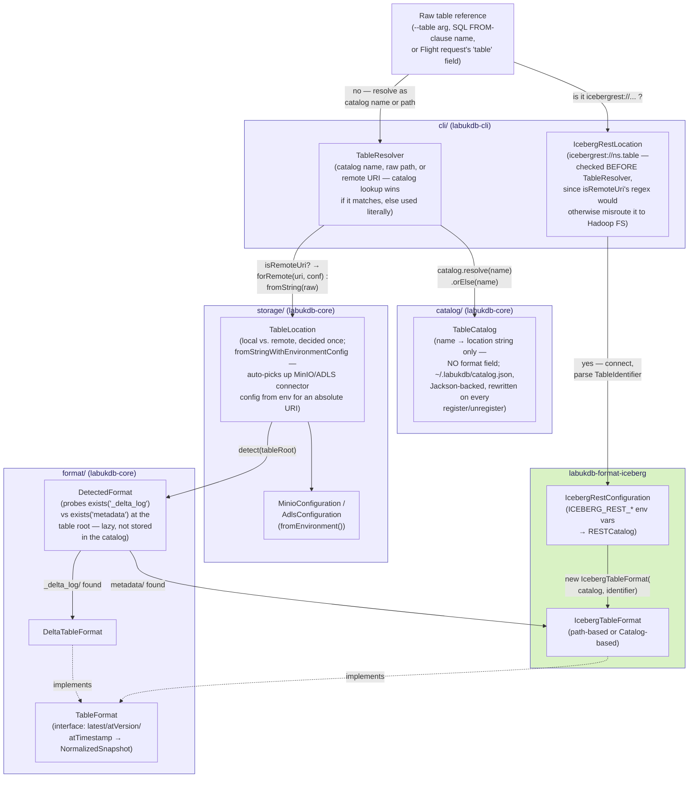

# labukDB — Catalog Resolution + Format Detection

**`TableCatalog` — deliberate interim limitation**, stated plainly in its own javadoc: no format tag stored per entry. Nothing stops a Delta table and an Iceberg table from being registered under different names side by side — each consumer independently detects format at query time via `DetectedFormat`, not at registration time.

**`DeltaTableFormat` — real gap found and fixed (SQL engine Phase 1)**: it existed, unit-tested standalone, but had *only* a local-only `Path` constructor — `QueryCommand`'s actual Delta query path bypassed it entirely in favor of `SnapshotManager`/`Snapshot`/`AddFile` directly (confirmed by grep: zero references). Added `DeltaTableFormat(TableLocation)`, delegating to the already-remote-capable `SnapshotManager.forLocation` — the constructor migrating the query path onto it needed first, or MinIO Delta SQL queries would have silently broken.

Still true after the fix: Flight and cli's flag-based `--table` path still bypass `DeltaTableFormat` for Delta (unchanged, out of scope) — only cli's `--sql` path uses it, via `core.logical.LogicalPlanExecutor`.
