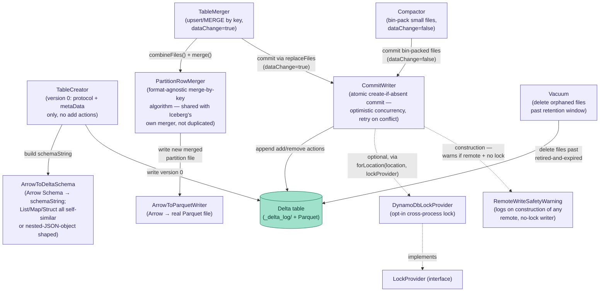

# labukDB — Delta Write Path (`log/`)

**`CommitWriter` — confirmed broken** (real 8-process stress test against real MinIO, not assumed): remote, no lock — plain append *and* `TableMerger`/`Compactor` both lose commits silently under genuine concurrency. MERGE is the worse failure mode (7 of 8 inserts lost, zero exceptions) since its commit unit replaces the whole partition, not just adds a file.

Remote, **with** lock (`DynamoDbLockProvider`): **done, live-verified** — the same failing scenarios pass with it engaged. `TableMerger`/`Compactor` gained their own lock-accepting overloads specifically to close this (previously only plain `appendBatch` could opt in).

Local disk: safe unconditionally, lock never needed (real atomic filesystem ops).

**`DynamoDbLockProvider` — root cause** (not the lock's design, the thing it mitigates): S3-compatible storage's conditional PUT isn't always honored under concurrency the way local disk's `CREATE_NEW` is. DynamoDB's own conditional `PutItem` *is* proven atomic (8-thread test: 1 success, 7 clean conflicts) — chosen because it mirrors real Delta Lake OSS's own `S3DynamoDBLogStore` pattern, not invented.

Real regression fixed: 8 processes racing `ensureTableExists()` against a brand-new lock table all hit `ResourceNotFoundException` then raced `createTable` — 6 of 8 got an uncaught `ResourceInUseException`. Fixed by catching it and falling through to the existing poll-until-ACTIVE loop.
