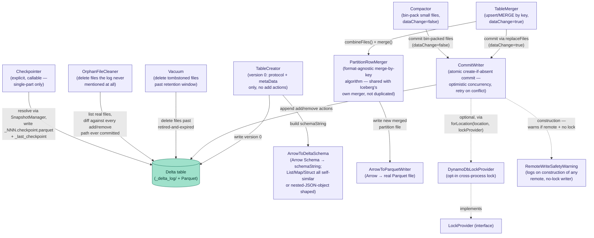

# labukDB — Delta Write Path (`log/`)

**The flow**: `TableCreator` is how a Delta table starts existing at all — it writes version 0 of the commit log (just the `protocol` and `metaData` actions, with `ArrowToDeltaSchema` building the schema string), no data files yet. From there, `CommitWriter` is the one path every later write goes through: it reads the latest committed version, builds a new commit describing which files were added or removed, and writes it atomically as the next version — retrying if another writer got there first. `TableMerger` (upsert/MERGE by key) and `Compactor` (bin-packing small files together) don't write the table directly; each produces a new Parquet file first — `TableMerger` via the shared `PartitionRowMerger`, which does the actual merge-by-key logic; `Compactor` by just concatenating — and then hands the result to `CommitWriter` to commit. The difference shows up in how that commit is tagged: `TableMerger`'s says `dataChange=true` (row values actually changed), `Compactor`'s says `dataChange=false` (same data, just repacked into fewer files). `Vacuum` is separate again — it never writes a new commit; it only deletes the physical bytes of files an *earlier* commit already marked as removed, once they're old enough. `OrphanFileCleaner` (new) covers the gap `Vacuum` genuinely can't: a Parquet file sitting in storage that no commit, past or present, ever mentioned at all — not even as a `remove` tombstone. The realistic cause is a writer that wrote its data file (every write path here writes the file before attempting its commit) and then never successfully committed — a crash, an exhausted OCC retry, a killed process. It independently lists every real file in the table directory (excluding `_delta_log/`), diffs that against the full commit history's `add`/`remove` paths, and deletes whatever's left over and old enough — the same retention-window safety `Vacuum` uses, so a genuinely in-flight writer's uncommitted file is never mistaken for an orphan. `Checkpointer` (new) is the same shape as `Vacuum`/`Compactor` — an explicit, callable operation, not wired into `CommitWriter` on any automatic cadence — but it never writes a new commit either: it resolves a version via `SnapshotManager` (the exact same replay a query would get) and materializes that snapshot's add/metaData/protocol state into a single-part Parquet checkpoint plus `_last_checkpoint`, so a later cold start can skip replaying the full JSON history. `LockProvider` is an optional add-on to `CommitWriter`: when supplied, every commit also coordinates through an external lock (`DynamoDbLockProvider` is the shipped implementation) before writing, and `RemoteWriteSafetyWarning` logs a warning on construction if you're writing to remote storage without one.

**`CommitWriter` — confirmed broken** (real 8-process stress test against real MinIO, not assumed): remote, no lock — plain append *and* `TableMerger`/`Compactor` both lose commits silently under genuine concurrency. MERGE is the worse failure mode (7 of 8 inserts lost, zero exceptions) since its commit unit replaces the whole partition, not just adds a file.

Remote, **with** lock (`DynamoDbLockProvider`): **done, live-verified** — the same failing scenarios pass with it engaged. `TableMerger`/`Compactor` gained their own lock-accepting overloads specifically to close this (previously only plain `appendBatch` could opt in).

Local disk: safe unconditionally, lock never needed (real atomic filesystem ops).

**`DynamoDbLockProvider` — root cause** (not the lock's design, the thing it mitigates): S3-compatible storage's conditional PUT isn't always honored under concurrency the way local disk's `CREATE_NEW` is. DynamoDB's own conditional `PutItem` *is* proven atomic (8-thread test: 1 success, 7 clean conflicts) — chosen because it mirrors real Delta Lake OSS's own `S3DynamoDBLogStore` pattern, not invented.

Real regression fixed: 8 processes racing `ensureTableExists()` against a brand-new lock table all hit `ResourceNotFoundException` then raced `createTable` — 6 of 8 got an uncaught `ResourceInUseException`. Fixed by catching it and falling through to the existing poll-until-ACTIVE loop.

**`Checkpointer` — real regression found and fixed via an actual round trip through real Spark** (local Spark 3.5.3 + Delta 3.0.0, not assumed): a table built by `TableCreator`, written via `CommitWriter`, checkpointed by `Checkpointer`, opened by a real Spark session — row count and values matched, but only after fixing a real gap the first attempt surfaced: Spark's own Delta reader throws a `NullPointerException` reading `metaData.format` when that struct is absent, and `MetadataAction` (shared by both JSON commits and checkpoints) never had one. Fixed once, in one class, so it closed the gap for every write path at once, not just `Checkpointer`'s own.

**`OrphanFileCleaner` — live-verified against real MinIO**, including the one genuinely new piece its remote path needed: independently listing real files in a bucket (`FileSystem.listFiles(path, recursive=true)`), not just targeted deletion of a path the log already names (all `Vacuum`/`Compactor` needed). The test writes a real, uncommitted Parquet file straight to MinIO (simulating a crashed writer) alongside a genuinely committed one, then confirms only the uncommitted file's bytes are actually gone afterward.
