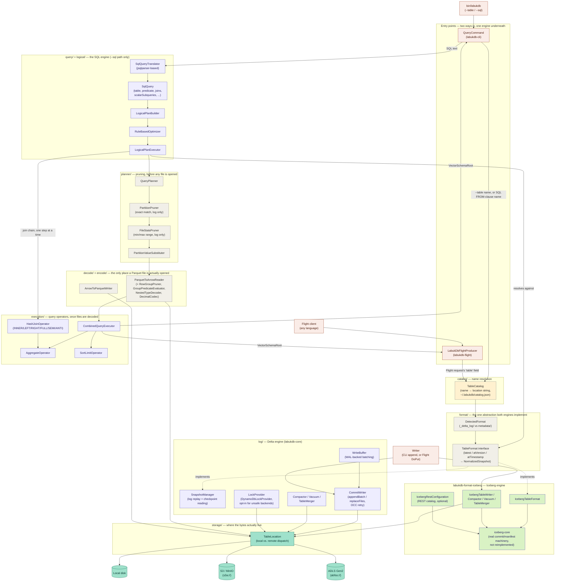

# labukDB — Full System Architecture

The other diagrams in this folder each zoom into one slice (module boundaries, one format's write path, the read path's pruning stack, the SQL engine's own IR, one Flight round trip). This one is the single picture that ties every layer together, write path and read/query path both, in one place.

## The flow

**Two entry points, one engine.** `QueryCommand` (CLI) and `LabukDbFlightProducer` (Flight server) are the only two places a request enters this system — everything below them is shared, format-agnostic code. A name (`--table`, a SQL `FROM` clause, or a Flight request's `table` field) resolves through `TableCatalog`, then `DetectedFormat` decides, lazily, whether it's looking at a Delta table (`_delta_log/`) or an Iceberg table (`metadata/`), and hands back the matching `TableFormat` implementation — `SnapshotManager` for Delta, `IcebergTableFormat` for Iceberg — both exposing the exact same `latest()`/`atVersion()`/`atTimestamp()` surface, so nothing above this point ever needs to know which format it actually got.

**The SQL engine only exists on one of the two read paths.** `--sql` text goes through `SqlQueryTranslator` → a `LogicalPlan` tree → `RuleBasedOptimizer` → `LogicalPlanExecutor`, which resolves the (possibly multi-table, possibly decorrelated-subquery) plan into the files each table actually needs to scan. Flight's own query protocol is a separate, pre-decomposed JSON shape — it never goes through the SQL translator at all, by design (mapping it onto the same `LogicalPlan` is named future work in the SQL-engine diagram, not done here). Either way, both paths converge on the exact same `planner/` → `decode/` → `execution/` machinery underneath.

**Pruning happens three times, each cheaper than the last.** `QueryPlanner` runs `PartitionPruner` (exact match against partition values already in the log) and `FileStatsPruner` (min/max range check against file stats already in the log) *before a single Parquet file is opened*. Only files that survive both get decoded at all — `ParquetToArrowReader` does the final, exact row-level filtering (`GroupPredicateEvaluator`, fused with decode) on whatever's left.

**Execution operators only run once rows are actually in memory.** `CombinedQueryExecutor` is the one that decodes every surviving file and concatenates them; `HashJoinOperator` folds a join chain together one step at a time (feeding each step's combined output back in as the next step's left side); `AggregateOperator`/`SortLimitOperator` run on whatever combined result needs grouping or ordering. A plain filtered scan with nothing to combine skips all of this and streams straight from `decode/` to the caller, one file at a time, never materializing the whole result.

**The write path is shorter and almost entirely format-specific.** A writer (a CLI append, or a Flight `DoPut`) goes straight to `CommitWriter` (Delta) or `IcebergTableWriter` (Iceberg) — `WriteBuffer` sits in front of Delta's writer as a WAL-backed batching layer; Iceberg commits immediately, with no equivalent buffer. Both ultimately call through to `storage/`'s `TableLocation`, which is the one place that decides local-disk-vs-remote and picks the right connector configuration for S3/MinIO/ADLS. Concurrent writers on an unsafe remote backend (confirmed broken on at least one real MinIO deployment under genuine concurrency) opt into `LockProvider`/`DynamoDbLockProvider` for real mutual exclusion — everything else here assumes a single writer, or a backend whose own conditional-write guarantee can actually be trusted.

**`iceberg-core` does Iceberg's real commit/manifest work — it isn't reimplemented.** This is the one deliberate asymmetry in an otherwise format-agnostic system: Delta's transaction-log protocol is implemented from scratch in `log/`, but Iceberg's own reference Java library already does that job correctly, so `IcebergTableFormat`/`IcebergTableWriter` build on top of it rather than re-deriving Iceberg's manifest format independently.
