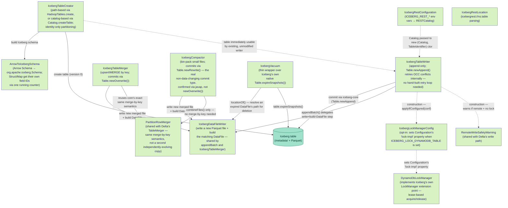

# labukDB — Iceberg Write Path (`labukdb-format-iceberg`)

**The flow**: mirrors Delta's shape with Iceberg's own machinery underneath. `IcebergTableCreator` creates a brand-new table (via `iceberg-core`'s own `Table.create`, path-based or catalog-based), building the schema through `ArrowToIcebergSchema`. Once a table exists, `IcebergTableWriter` is the plain-append path — it hands the actual file-writing off to `IcebergDataFileWriter` (which writes the Parquet file and builds the matching Iceberg `DataFile` reference), then commits via `iceberg-core`'s own `Table.newAppend()`, which already has its own built-in optimistic-concurrency retry (unlike Delta's `CommitWriter`, no hand-rolled retry loop was needed here). `IcebergTableMerger` and `IcebergCompactor` both also go through `IcebergDataFileWriter` to produce their new file, then commit differently: `IcebergTableMerger` via `Table.newOverwrite()` (a real data change), reusing the exact same `PartitionRowMerger` merge-by-key logic Delta's `TableMerger` uses; `IcebergCompactor` via `Table.newRewrite()`, Iceberg's dedicated non-data-changing commit type. `IcebergVacuum` is a thin wrapper over Iceberg's own native `Table.expireSnapshots()` — Iceberg ships this directly, whereas Delta's `Vacuum` had to hand-roll the equivalent. `DynamoDbLockManager`/`IcebergLockManagerConfig` are the optional external-lock add-on (the same idea as Delta's `LockProvider`, implementing Iceberg's own `LockManager` extension point instead). `IcebergRestConfiguration`/`IcebergRestLocation` handle the alternate way of reaching a table — through a REST catalog service rather than a raw path — which `IcebergTableWriter` can use in place of a path-based constructor.

**`IcebergTableWriter` — confirmed broken** under genuine concurrent writers on real MinIO, root cause traced into `iceberg-core`'s own `HadoopTableOperations.renameToFinal`: the default `LockManager` (`InMemoryLockManager`) is a plain `HashMap` per-JVM — zero protection across separate processes — then `fs.rename()` (copy+delete on S3A, not atomic) lets every racing writer "succeed" with no conflict detected. MERGE confirmed separately broken too (4 of 8 concurrent inserts lost).

With lock (`DynamoDbLockManager`): **done, live-verified** — append *and* MERGE both pass with it engaged. Full write lifecycle (create → append → merge → compact → vacuum) proven end-to-end against real MinIO.

**`DynamoDbLockManager`**: the same `ResourceInUseException` bootstrap race fixed here as Delta's `DynamoDbLockProvider` — found via *this* class's own 8-separate-process test first, then confirmed Delta's lock had the identical unprotected `createTable` call. Scope deliberately smaller than Delta's lock: a lease-based steal, not a crash-recovery system — Iceberg's own `SnapshotProducer.commit()` retry loop already handles everything else.

**`IcebergRestConfiguration` — REST catalog + real MinIO, full data round trip: done, live-verified.** Solved with `CATALOG_WAREHOUSE=s3a://...` (not `s3://`) so the REST server's reported locations resolve against this project's own `MinioConfiguration`. Real live-only issues found and fixed along the way: container DNS resolving the MinIO hostname to its own loopback (fixed via `--add-host host-gateway`), and the container's JVM not trusting a local `mkcert` dev cert (fixed via `keytool`, run as root).
