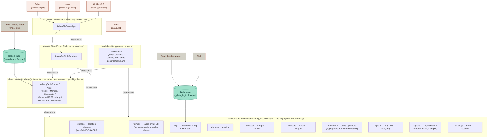

# labukDB — Module Dependency Overview

**Legend**: lavender boxes are `labukdb-core`/`flight`/`server-app`/`cli`; green is `labukdb-format-iceberg`; teal cylinders are real storage (Delta/Iceberg tables); peach boxes are external actors (writers or clients).

**Dependency direction, the one rule that shapes this whole layout**: it runs *one way* — `core` never depends on `format-iceberg`. This is why format detection (`DetectedFormat`) lives in `core`, but actually *constructing* an `IcebergTableFormat` happens in `cli`/`flight` — the first layer that can see both modules. `core.logical.LogicalPlanExecutor` follows the same rule: it takes an already-opened `TableFormat` rather than detecting or opening the table itself.

**Two query paths inside `cli/`, both real**: `--table`/`--filter`/`--columns` (flag-based, unchanged since v1) and `--sql "<SELECT...>"` (the SQL engine — logical plan IR, optimizer, joins). Both end up calling the exact same `execution/` operators underneath.
