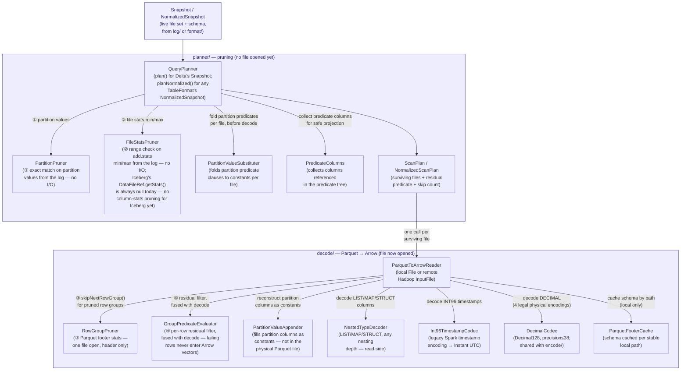

# labukDB — Read Path: Pruning (`planner/`) + Decode (`decode/`)

**The flow**: a `Snapshot`/`NormalizedSnapshot` — the live file list and schema for one table version, already resolved by `log/` or `format/` — goes into `QueryPlanner`, which does everything inside `planner/` *without opening a single data file*. `PartitionPruner` throws out files whose partition values can't match the query's filter; `FileStatsPruner` does the same using each file's own min/max column statistics, already recorded in the log or manifest. Alongside that, `PartitionValueSubstituter` rewrites the filter to fold out partition-column clauses into constants per file (since those columns don't physically exist inside the Parquet file itself), and `PredicateColumns` works out which columns the filter actually touches, so they get decoded later even if they're not in the `SELECT` list. All of that produces a `ScanPlan`/`NormalizedScanPlan` — the final surviving file list, plus whatever filter is left to check row by row. From there, `decode/` takes over, one file at a time, through `ParquetToArrowReader`: `RowGroupPruner` skips whole row groups using the Parquet file's own footer statistics (the first point any file is actually opened, but only its footer), then `GroupPredicateEvaluator` checks the remaining filter against each row as it's decoded — a row that fails never gets materialized into an Arrow vector at all. In that same decode pass, `PartitionValueAppender` fills in the partition columns as constants, `NestedTypeDecoder` handles any `LIST`/`MAP`/`STRUCT` columns, `Int96TimestampCodec` and `DecimalCodec` handle their respective legacy/precision-sensitive types, and `ParquetFooterCache` avoids re-reading the same file's schema footer on a later query.

**Four pruning levels, cheapest first** — ① and ② never open a file at all; ③ opens one file's footer only; ④ is fused with decode itself, zero extra materialization.

**`NestedTypeDecoder`**: a recursive dispatcher — any depth of LIST/MAP/STRUCT nesting, four leaf primitive kinds (float/double/int32/int64/string). Decimal/timestamp/boolean leaves inside a nested position are a separate, not-yet-wired expansion — deliberately, to avoid a schema that builds but a reader that can't actually decode it.

**`ParquetToArrowReader` — the projection-pushdown fix this project found the hard way**: the physical read set is OUTPUT columns UNION predicate columns (via `PredicateColumns.collect`) — a `WHERE` on a column not in the `SELECT` list used to throw `InvalidRecordException` before this, since the predicate referenced a column never decoded.
