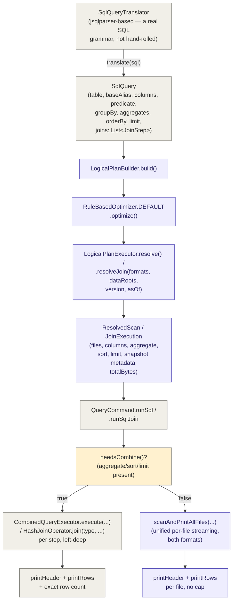
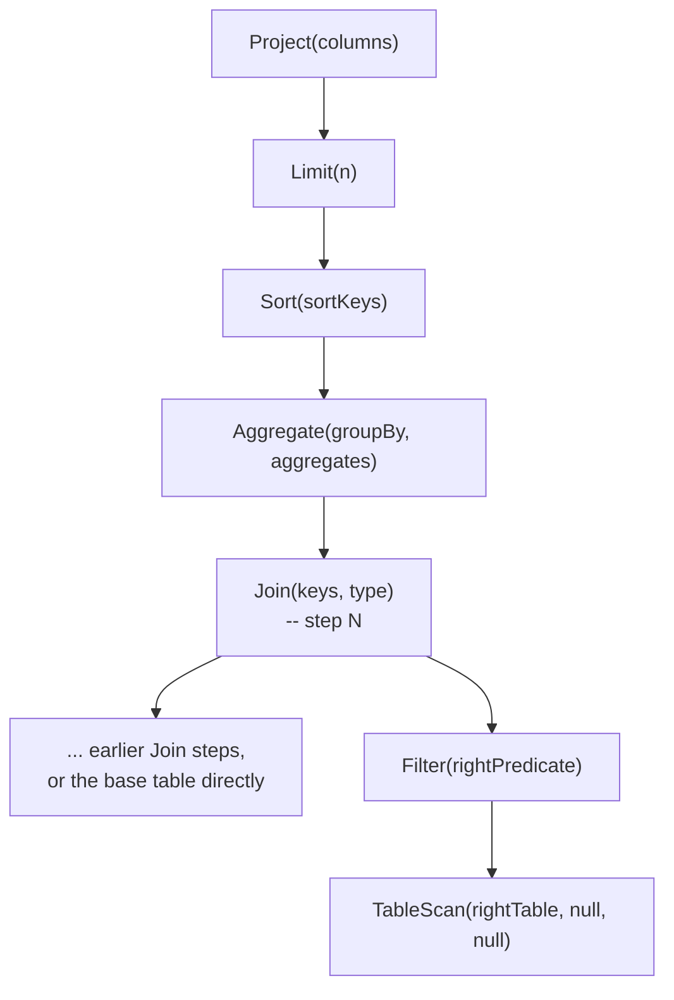
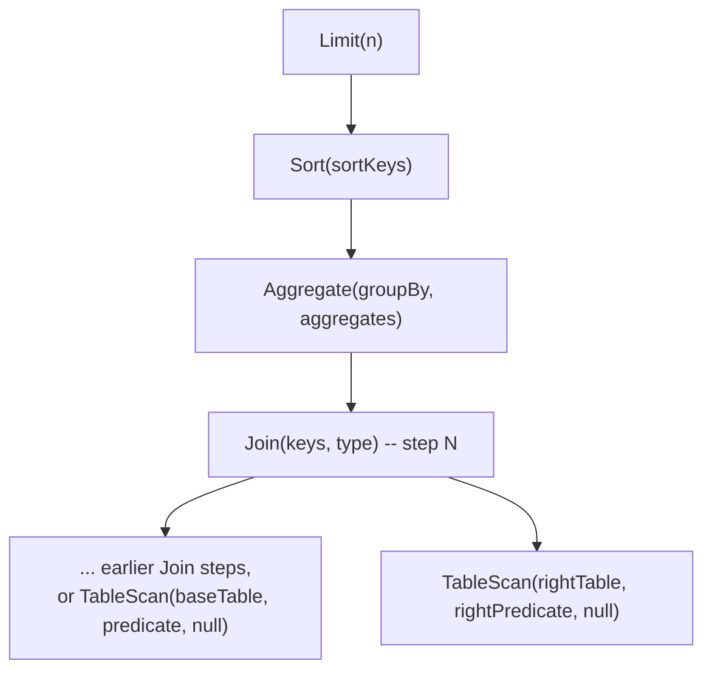

# labukDB — SQL Engine Architecture (`core.logical`)

**The flow**: `SqlQueryTranslator` parses the raw SQL text into a `SqlQuery` record — not yet a tree, just the parsed pieces (table, columns, predicate, `groupBy`, aggregates, `orderBy`, limit, and an ordered `joins` list, one `JoinStep` per table after the base). `LogicalPlanBuilder` turns that into an actual `LogicalPlan` tree (shown below, before optimization), and `RuleBasedOptimizer` rewrites it into a leaner shape (also shown below) by absorbing filters onto their scan and pruning columns down to what's actually needed. `LogicalPlanExecutor` resolves that optimized plan into the files that actually need to be scanned, returning a `ResolvedScan` (single table) or `JoinExecution` (a left-deep chain of one or more tables). From there, `QueryCommand` decides how to run it: a query that needs aggregation, sorting, a limit, or a join goes through `CombinedQueryExecutor`/`HashJoinOperator`, which fully materializes what it needs before producing one combined result; a plain filtered scan with nothing to combine streams straight through `scanAndPrintAllFiles`, one file at a time, without ever loading the whole result into memory.

**Tree shape before optimization** (`LogicalPlanBuilder`'s output — one `Project` always wraps the whole thing; each `Join` step adds a fresh `TableScan` branch on its right, chained left-deep for 3+ tables):

**Tree shape after optimization** (`PushFilterIntoScan` absorbs each `Filter` directly onto its own `TableScan`, recursing through nested `Join`s for free; `PushProjectIntoScan` absorbs and drops the outer `Project` — *unless* a `Join` is present with no `Aggregate` above it, in which case `Project` survives to trim the join chain's wider combined columns back down to the real `SELECT` list):

Only nodes the query actually used survive — e.g. a plain `SELECT x FROM t` optimizes straight down to one bare `TableScan`, nothing wrapping it at all. `requestedColumns` is the exact union `QueryCommand` used to compute inline before this rule existed: group-by + aggregate-input columns when aggregating, else `SELECT` list + `ORDER BY` columns. `WHERE`-only columns need no explicit handling — `ParquetToArrowReader` already unions predicate columns in at decode time. For a join, column pruning is deliberately *not* pushed across the join boundary — each table's `TableScan` keeps `requestedColumns == null` ("decode everything"), a stated simplification.

**A `Join` node's `left` is always "accumulated so far" (the base table, or an earlier `Join`), `right` is always this step's own fresh table** — a real invariant, not just a naming convention, that holds for every join type including `RIGHT`: `RIGHT` reaches this tree completely unchanged (no child-swapping at build time) and is only ever resolved inside `HashJoinOperator`, which delegates it to its `LEFT` implementation with every argument swapped at call time (see that class's own javadoc). `JoinKey.leftColumn` is bare only for a chain's first step; for every later step it's already alias-qualified (`"<alias>.<column>"`), since by then the left side is a prior `HashJoinOperator` call's own renamed output, not a fresh decode — `rightColumn` is always bare.

**`LogicalPlanExecutor` deliberately does NOT open the table itself.** Format detection (Delta vs. Iceberg vs. REST-catalog Iceberg) needs cross-module visibility into `labukdb-format-iceberg` that `labukdb-core` doesn't have. `QueryCommand` (in `labukdb-cli`, which depends on both modules) resolves every table name into an already-open `TableFormat` + the `TableLocation` its data files resolve against, *first*, then hands the whole ordered list in here. This class's job starts at snapshot resolution (`format.latest()`/`atVersion()`/`atTimestamp()`) and ends at "files to scan" — the genuinely format-agnostic part. For a join, every table is resolved completely independently via the same `resolveSide` helper, which is what makes a Delta↔Iceberg join work with zero format-specific join code — a free consequence of the design, not a built feature. `resolveSide` also sums each table's surviving files' `DataFileRef.getSizeBytes()` into `ResolvedScan.totalBytes` — the one cheap, format-agnostic signal `QueryCommand` uses for cost-based build/probe side selection on an `INNER` step (build the hash table from whichever side has fewer total bytes; `LEFT`/`RIGHT`/`FULL` keep a fixed, correctness-driven build side instead — see `HashJoinOperator`'s own javadoc).

Real gap found and fixed to make this true: `DeltaTableFormat` existed but only had a local-only `Path` constructor — would have silently broken MinIO Delta SQL queries if wired in naively. Added `DeltaTableFormat(TableLocation)`, delegating to the already-remote-capable `SnapshotManager.forLocation`.

**Deliberate, named behavioral improvement, not a silent regression**: Iceberg's CLI path previously *always* went through `CombinedQueryExecutor` regardless of whether the query aggregated/sorted/limited. Now streams per-file for a plain `SELECT` on either format, matching Delta's existing smarter behavior — lower memory, identical output.

## Scope boundaries, explicit

- Flight (`LabukDbFlightProducer`) untouched — its own JSON query protocol is a separate, pre-decomposed shape, never SQL text. Mapping it onto this same `LogicalPlan` is natural future work, not done here.
- `Predicate`'s leaves are still only `column OP literal` or (for a join's `ON`/key columns) `column OP column` within an equi-join — no generic cross-column comparison outside that, no `NOT`.
- `CROSS`/`NATURAL`/`SEMI` joins and non-equi `ON` conditions are rejected with a clear error, not implemented.
- A `WHERE` condition on the non-preserved side of a `LEFT`/`RIGHT` join, or on either side of a `FULL` join, is rejected with a clear error rather than silently pushed somewhere unsafe — pre-filtering it before the join would change which rows get null-padded. A condition on the preserved side is unaffected and works normally. Evaluating such a condition correctly (after the join, against the null-padded result) is deferred, not attempted incorrectly.
- Cost-based build/probe side selection is a byte-size heuristic (smaller total file size builds the hash table), applied per `INNER` step only — not real cardinality-based costing, and not join-*order* reordering (which tables join first is still exactly what the SQL text said, never reordered).
- Still not supported: subqueries, computed `SELECT` expressions (every item must be a bare column or one of the 5 aggregate functions).

## The arc, where it actually stands

Phase 1 (logical plan IR + optimizer shell) — **done**. Phase 2 (`LIMIT` early-termination without `ORDER BY`/`GROUP BY`) — **done**. Phase 3 (equi-joins: `INNER`/`LEFT`/`RIGHT`/`FULL`, any number of tables, combined with `GROUP BY`/aggregates/`ORDER BY`/`LIMIT`, plus byte-size-based build/probe side selection for `INNER` steps) — **done**, live-verified against real MinIO including a Delta→Delta→Iceberg mixed-format 3-way chain and `LEFT`/`FULL` unmatched-row null-padding. Phase 4 (subqueries: scalar, `IN (SELECT...)`, `EXISTS`) — not started.
