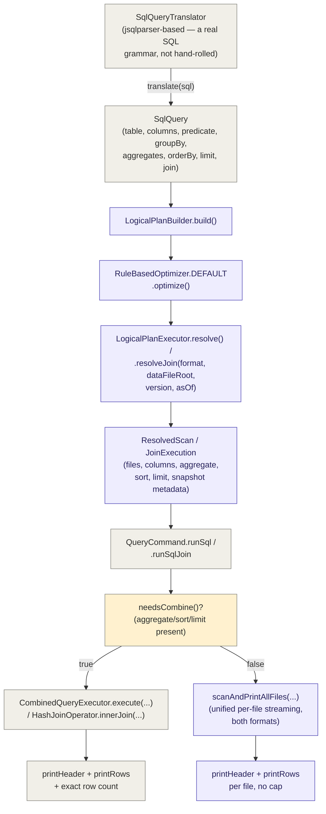
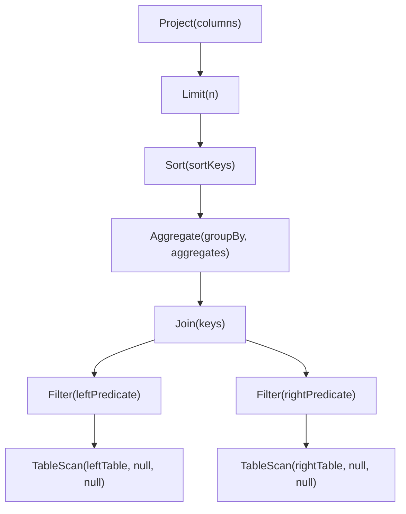
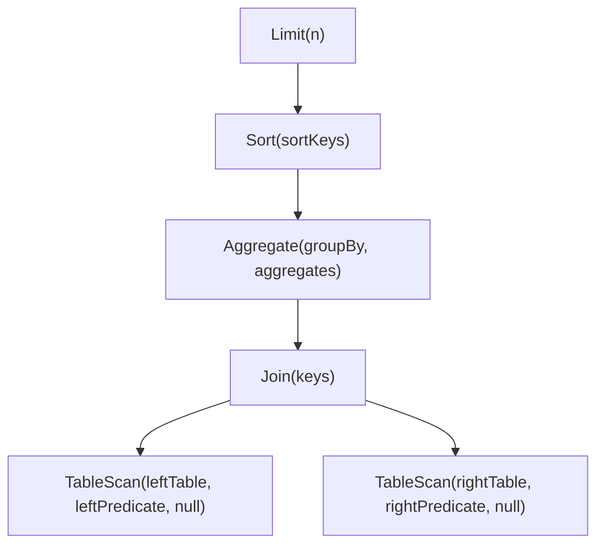

# labukDB — SQL Engine Architecture (`core.logical`)

**Tree shape before optimization** (`LogicalPlanBuilder`'s output — one `Project` always wraps the whole thing, and `Join` adds a second `TableScan` branch when the query joins two tables):

**Tree shape after optimization** (`PushFilterIntoScan` absorbs each `Filter` directly onto its own `TableScan`; `PushProjectIntoScan` absorbs and drops the outer `Project` — *unless* a `Join` is present with no `Aggregate` above it, in which case `Project` survives to trim the join's wider combined columns back down to the real `SELECT` list):

Only nodes the query actually used survive — e.g. a plain `SELECT x FROM t` optimizes straight down to one bare `TableScan`, nothing wrapping it at all. `requestedColumns` is the exact union `QueryCommand` used to compute inline before this rule existed: group-by + aggregate-input columns when aggregating, else `SELECT` list + `ORDER BY` columns. `WHERE`-only columns need no explicit handling — `ParquetToArrowReader` already unions predicate columns in at decode time. For a join, column pruning is deliberately *not* pushed across the join boundary — each side's `TableScan` keeps `requestedColumns == null` ("decode everything"), a stated simplification.

**`LogicalPlanExecutor` deliberately does NOT open the table itself.** Format detection (Delta vs. Iceberg vs. REST-catalog Iceberg) needs cross-module visibility into `labukdb-format-iceberg` that `labukdb-core` doesn't have. `QueryCommand` (in `labukdb-cli`, which depends on both modules) resolves the table name into an already-open `TableFormat` + the `TableLocation` its data files resolve against, *first*, then hands both in here. This class's job starts at snapshot resolution (`format.latest()`/`atVersion()`/`atTimestamp()`) and ends at "files to scan" — the genuinely format-agnostic part. For a join, each side is resolved completely independently via the same `resolveSide` helper, which is what makes a Delta↔Iceberg join work with zero format-specific join code — a free consequence of the design, not a built feature.

Real gap found and fixed to make this true: `DeltaTableFormat` existed but only had a local-only `Path` constructor — would have silently broken MinIO Delta SQL queries if wired in naively. Added `DeltaTableFormat(TableLocation)`, delegating to the already-remote-capable `SnapshotManager.forLocation`.

**Deliberate, named behavioral improvement, not a silent regression**: Iceberg's CLI path previously *always* went through `CombinedQueryExecutor` regardless of whether the query aggregated/sorted/limited. Now streams per-file for a plain `SELECT` on either format, matching Delta's existing smarter behavior — lower memory, identical output.

## Scope boundaries, explicit

- Flight (`LabukDbFlightProducer`) untouched — its own JSON query protocol is a separate, pre-decomposed shape, never SQL text. Mapping it onto this same `LogicalPlan` is natural future work, not done here.
- `Predicate`'s leaves are still only `column OP literal` or (for a join's `ON`/key columns) `column OP column` within an equi-join — no generic cross-column comparison outside that, no `NOT`.
- Still not supported: `LEFT`/`RIGHT`/`FULL` joins, non-equi join conditions, 3+-way joins, cost-based build/probe side selection, subqueries, computed `SELECT` expressions (every item must be a bare column or one of the 5 aggregate functions).

## The arc, where it actually stands

Phase 1 (logical plan IR + optimizer shell) — **done**. Phase 2 (`LIMIT` early-termination without `ORDER BY`/`GROUP BY`) — **done**. Phase 3, increment 1 (two-table `INNER` equi-join) — **done**, live-verified against real MinIO, including a Delta↔Iceberg mixed join. Phase 3, increment 2 (`GROUP BY`/aggregates/`ORDER BY`/`LIMIT` combined with a `JOIN`) — **done**, live-verified against real MinIO. Phase 3's remaining piece (`LEFT`/`RIGHT`/`FULL` joins, 3+-way joins, cost-based join-side selection) — not started. Phase 4 (subqueries: scalar, `IN (SELECT...)`, `EXISTS`) — not started.
