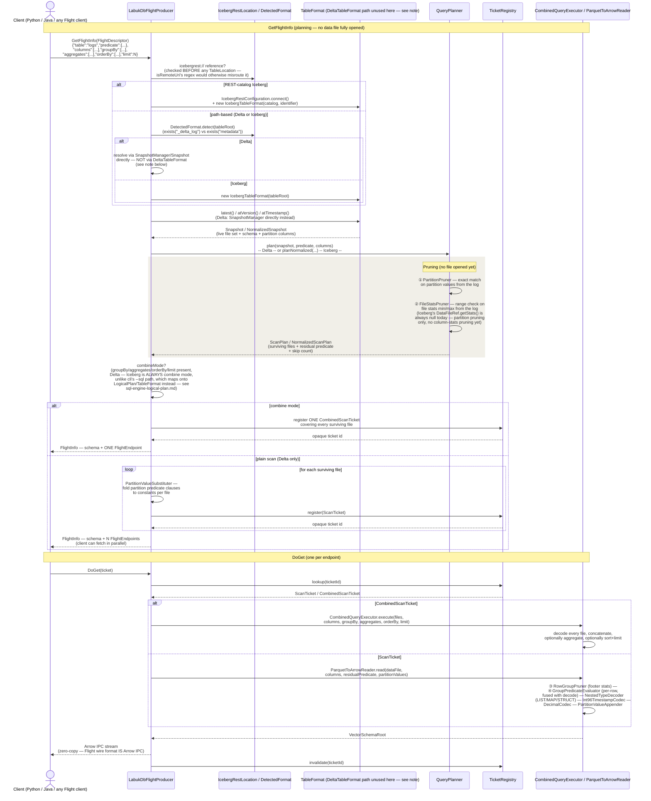

# labukDB — Flight Query Round Trip

**Delta's query path bypasses `DeltaTableFormat` here** — confirmed by grep: zero references to it in `LabukDbFlightProducer`. This is unchanged by the SQL engine work, which only wired `DeltaTableFormat` into cli's `--sql` path (see `sql-engine-logical-plan.md`). Mapping Flight's own query protocol onto the same `LogicalPlan`/`TableFormat` path is natural future work, not done yet.

**`DoPut` (write path, not shown above)**: Delta buffers via `WriteBuffer` (WAL-backed, flush on size/time threshold); Iceberg commits immediately, one `DoPut` = one Iceberg commit, no `WriteBuffer` equivalent. Both live-MinIO-verified.
