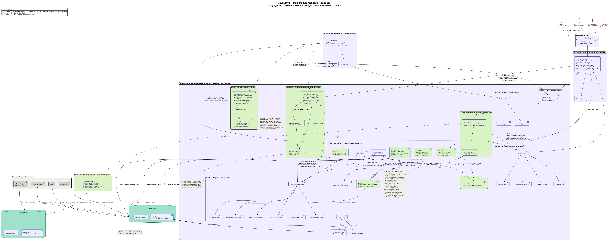

# labukDB v2 — Multi-Module Architecture

**Status: planned, not implemented.** This document captures the agreed
design for turning `delta-flight-engine` (a read-only Delta Lake gateway)
into **labukDB** — a multi-format lakehouse database that reads and writes
Delta tables, reads Iceberg tables, and is usable either as an embedded
Java library or as a Flight server. Nothing here exists in code yet; see
[ARCHITECTURE.md](../ARCHITECTURE.md) for the v1 system this plan builds
on top of.

Diagram sources: [`labukdb-v2-module-architecture.puml`](labukdb-v2-module-architecture.puml)
(PlantUML source — edit this), rendered as
[`labukdb-v2-module-architecture.pdf`](labukdb-v2-module-architecture.pdf) and
[`.png`](labukdb-v2-module-architecture.png).

Legend: **lavender** boxes are reused from v1 as-is (package renamed
`com.labuk.deltaflight` → `com.labuk.labukdb`); **amber** boxes are new —
they don't exist yet.

---

## Why this shape

Three decisions drive the whole layout:

1. **Don't invent a new storage/commit format — stay protocol-compatible
   with Delta.** labukDB becomes a *writer* of the same `_delta_log`
   protocol it already reads, instead of inventing its own WAL/commit
   format. A table labukDB writes stays readable by Spark, DuckDB,
   `delta-rs`, Databricks; a Spark-written table stays readable by
   labukDB. This is the single highest-leverage decision in the whole
   plan — it turns "build a database" into "build a writer for a log
   format already deeply understood as a reader."
2. **The gateway/Iceberg plan is reused whole, not replaced.** `planner/`,
   `decode/`, `storage/` don't change. `DeltaTableFormat` and
   `IcebergTableFormat` both implement the same `TableFormat` interface
   designed for the multi-format gateway — labukDB is a strict superset
   of that plan, not a different path.
3. **The embeddable core stays dependency-light.** `labukdb-core` has no
   Flight/gRPC dependency, so an application that only wants in-process
   query access (the DuckDB use case) isn't forced to pull in Netty/gRPC
   just because the project also offers a server mode.

## Two access modes, one engine

| Mode | Shape | Analogous to |
|---|---|---|
| **Embedded library** | Add `labukdb-core` (+ format modules) as a Maven dependency, call the Java API in-process, no server to run | DuckDB — the engine lives inside your JVM process |
| **Flight server** | Run `labukdb-server-app`, connect from any language with an Arrow Flight binding | Postgres/MySQL — a separate process, network protocol |

DuckDB itself only offers the first mode. labukDB offers both from the
same core, which is the actual differentiator, not an imitation of either
system alone.

## Modules

| Module | Contains (today's package) | Depends on | Produces |
|---|---|---|---|
| `labukdb-core` | `log/`, `planner/`, `decode/`, `storage/`, `catalog/` (reused) + `encode/`, `execution/`, `format/` (new) | — | embeddable library jar |
| `labukdb-format-iceberg` | ✅ **Done** — `IcebergTableFormat`, delegating manifest/table loading to `iceberg-core:1.12.0`'s `HadoopTables` | `labukdb-core`, `iceberg-core` | embeddable library jar (optional) |
| `labukdb-flight` | `flight/` (adds `DoPut`) | `labukdb-core` [+ `labukdb-format-iceberg`] | library jar |
| `labukdb-server-app` | `DeltaFlightServerApp` → `LabukDbServerApp` | `labukdb-core`, `labukdb-flight` | shaded standalone server jar |
| `labukdb-cli` | `cli/` | `labukdb-core` in-process — no Flight needed, same as today | shaded CLI executable |

## What's new inside `labukdb-core`

Everything else in the diagram (`log/`, `planner/`, `decode/`, `storage/`,
`catalog/`) is reused unchanged. Five subsystems are genuinely new:

- **`format/WriteBuffer` (Ingester)** — see [Write path: it's an LSM
  tree](#write-path-its-an-lsm-tree-at-file-granularity) below. Absorbs
  many small incoming writes in memory before they become a file.
- **`format/CommitWriter`** — the highest-risk piece. Reads the latest
  version, builds a new commit (add/remove actions), writes it atomically,
  detects conflicting concurrent commits, retries. This is where real
  database-correctness risk concentrates, not in the query path. See
  [Concurrent writes](#concurrent-writes) below.
- **`encode/ArrowToParquetWriter`** — the write-side mirror of
  `ParquetToArrowReader`; turns a flushed buffer into a Parquet file that
  `CommitWriter` then references in a commit.
- **`format/Compactor` and `format/Vacuum`** — bin-pack small files into
  an `OPTIMIZE`-style commit, and remove orphaned file bytes past a
  retention window. Needs the same concurrency-safety rigor as
  `CommitWriter` itself, since it rewrites files a reader or another
  writer might be mid-snapshot against.
- **`execution/`** — `FilterOperator` (formalizes the existing residual-
  predicate pass), `AggregateOperator` (`GROUP BY` + `SUM`/`COUNT`/
  `MIN`/`MAX`/`AVG`), `SortLimitOperator`. This is the piece that was
  missing to call this a "database" rather than a scan gateway — not a
  general SQL optimizer, just enough for real workloads.

`flight/DoPut` is the ingest entry point: it hands incoming Arrow batches
to `WriteBuffer` first, not straight to `ArrowToParquetWriter`.

## Write path: it's an LSM tree, at file granularity

`CommitWriter` + `Compactor` are already structurally an LSM tree — just
applied to whole files instead of individual rows, which is exactly the
shape Delta/Iceberg/Hudi and IOx (underneath InfluxDB 3.0) all share:

| Classic LSM (RocksDB/Cassandra) | labukDB (file-level LSM) |
|---|---|
| Memtable (in-memory sorted writes) | `WriteBuffer` |
| WAL (durability before flush) | `WriteBuffer`'s WAL |
| SSTable (immutable sorted file) | a committed Parquet file |
| Compaction (merge small SSTables) | `Compactor` |
| Tombstone / merge-on-read | `remove` actions in the commit log |

**Why `WriteBuffer` specifically earns its place, not just completeness
for the table above:** without it, every `DoPut` call would flush
straight to one new Parquet file + one new commit. Under frequent,
small writes — the exact ingestion pattern a time-series/metrics workload
produces — that's a tiny file and a log entry per call, and `Compactor`
would be permanently fighting a losing battle instead of doing periodic
cleanup. `WriteBuffer` buffers per table in memory, backed by a WAL for
crash durability, and only flushes to `ArrowToParquetWriter` →
`CommitWriter` when a size or time threshold is hit (e.g. 128 MB or 60
seconds, whichever comes first). It also serves reads directly — a query
sees its own very recent, not-yet-flushed writes by checking the buffer
alongside committed files, the classic LSM "check the memtable, then the
SSTables" read path. (This is also, concretely, what the "Arrow columns
in memory to cache hot data" box in InfluxDB 3.0's own architecture
diagram is — not just a read cache, the write buffer itself.)

## Concurrent writes

Since labukDB stays Delta-protocol-compatible, it inherits Delta's own
answer to concurrency rather than inventing one — optimistic concurrency
control (OCC):

1. Writer reads the latest version `V` (`SnapshotManager.latest()`).
2. Builds its change set (add/remove actions) against that snapshot.
3. Attempts to commit as `V+1` via an **atomic create-if-absent** write of
   `_delta_log/<V+1>.json` — must fail, not silently overwrite, if the
   file already exists.
4. Success → done. Failure (someone else won the race for `V+1`) →
   re-read the new latest version, check whether the winning commit's
   actions actually conflict with this writer's read/write set. No real
   conflict → rebase and retry as `V+2`. Real conflict → fail the
   transaction and surface it to the caller.
5. Bounded retries with backoff, to avoid livelock under contention.

The algorithm (steps 1–5) is well-documented and mechanical — **the
actual risk is step 3's atomic create-if-absent, per storage backend**,
and it's not uniform:

| Backend | Atomic create-if-absent | Status |
|---|---|---|
| Local disk | `Files.createFile(path, CREATE_NEW)` | Done, trivially atomic |
| S3 (native AWS) | `If-None-Match: *` conditional PUT, via Hadoop ≥3.4.2's S3A support ([HADOOP-19256](https://issues.apache.org/jira/browse/HADOOP-19256)) | **Implemented** (`log/HadoopLogStorage`, Hadoop bumped to 3.4.3) — verified only via local-filesystem substitution (`HadoopLogStorageTest`), **not a real AWS endpoint** |
| MinIO | Same S3A code path | **Implemented and verified against a real cluster** (`quay.io/minio/minio:latest`) — create, read-back, conflicting second create correctly threw `FileAlreadyExistsException`, original content survived. Not a guarantee for every MinIO build, but this common image works. |
| ADLS Gen2 | Create-without-overwrite-first, via `abfs` ([HADOOP-17215](https://issues.apache.org/jira/browse/HADOOP-17215), already in Hadoop 3.3.0+) | **Implemented**, same code path as S3/MinIO — **unverified against a real ADLS endpoint** |

Real Delta Lake OSS historically needed an external coordinator (a
DynamoDB table) for S3 specifically, before S3 gained native conditional
writes. This project would have hit the same problem if it had assumed
otherwise without checking — which is exactly why this was researched
before being implemented, not assumed.

**Where this leaves the single-writer-per-table recommendation:** the
atomic-write primitive itself is now implemented and real-verified for
local disk and MinIO, implemented-but-unverified for S3 and ADLS. That
derisks the *foundation* multi-writer OCC would sit on, but OCC's
conflict-detection/retry logic itself (steps 4–5 above) still isn't
built — labukDB remains single-writer-per-table until that's done, not
because the primitive is in doubt anymore but because the algorithm on
top of it hasn't been written yet.

## Build order

Not all five new subsystems carry equal risk — ordered to get something
demoable early and defer the highest-risk, least-verified piece until the
foundation under it is proven:

1. **Single-writer commit path, no `WriteBuffer` yet** — "append one
   commit atomically, read it back correctly," one Parquet file per
   write. Proves `ArrowToParquetWriter` and commit-JSON construction
   before anything else adds complexity on top.
2. **`WriteBuffer`** — insert the memtable/WAL layer between `DoPut` and
   (1), so file count stops being one-per-write. Do this *before* wiring
   `DoPut` into the public API, not after — retrofitting a buffer under
   an API clients already depend on is strictly harder.
3. **`DoPut` on Flight** — wires the ingest entry point to (1) + (2).
4. **Compaction / vacuum.**
5. **`execution/`** — independent of the write path, can happen in
   parallel with 1–4.
6. **Multi-writer OCC** — deferred, per the recommendation above, until
   the per-backend atomic-write verification in
   [Concurrent writes](#concurrent-writes) is actually done. v1 ships
   single-writer-per-table instead.

## Phase roadmap beyond v1 core

**Correction to an earlier framing:** a previous pass at this plan called
distributed ingestion and distributed query execution "explicitly out of
scope." That was wrong — they're required for the full architecture and
stay on the roadmap. What's true is only that they come *after* v1 core
(the write path above) is built and validated, not that they're dropped.
v1 core is the current priority; these are sequenced, not shelved.

| Phase | Scope | Status |
|---|---|---|
| `CommitWriter` (single-writer) + `encode/` | Build-order steps 1 | ✅ Done — tested against a fixture and a real table |
| `WriteBuffer` | Build-order step 2 | ✅ Done — auto-flush, crash recovery, tested |
| Remote atomic commits (S3/MinIO/ADLS) | `HadoopLogStorage.createCommitFile`, Hadoop bumped to 3.4.3 | ✅ Implemented; **MinIO real-infra verified**, S3/ADLS implemented-but-unverified |
| `format/TableFormat` + `DeltaTableFormat` | Additive SPI prep | ✅ Done, tested standalone |
| **Multi-format — `labukdb-format-iceberg`** | `IcebergTableFormat`, using `iceberg-core:1.12.0` (not hand-rolled) | ✅ **Done** — read-only, path-based (`HadoopTables`, no catalog service). Validated the `TableFormat` shape as intended: surfaced two real mismatches (`atVersion`'s Delta-sequential assumption vs. Iceberg's non-sequential `snapshotId`; `schemaString`'s Delta-JSON shape vs. Iceberg's typed `Schema`) — named, not silently papered over. Also empirically proved `decode/ParquetToArrowReader` is format-agnostic: reads an Iceberg-committed file with zero changes. Tested against a self-built fixture table (`iceberg-core`'s own create API), not a Spark/Trino-written one — same caveat `CheckpointReader` carries for Delta checkpoints. |
| `flight/DoPut` | Ingest endpoint | Not started — next, now that `WriteBuffer` exists to wire it to |
| `TableFormat` wired into `planner`/`flight`/`cli` | Still deferred | Two implementations now exist and have already informed the interface (see mismatches above) — wiring itself still not done |
| Read scale-out | Self-describing Flight tickets (encode the scan directly in the ticket bytes instead of a `TicketRegistry` lookup), stateless server replicas behind a load balancer | Not started — cheap once started, no new distributed-systems machinery needed since snapshot resolution is already stateless against shared object storage |
| Multi-writer OCC across machines | Per-backend atomic create-if-absent verification (S3/MinIO/ADLS — see [Concurrent writes](#concurrent-writes)), then OCC conflict/retry | Atomic-write primitive confirmed real on MinIO; conflict-detection/retry algorithm itself not started |
| **Distributed ingestion fleet** | Router + sharded Ingesters + a durable distributed WAL (not local-disk-per-node) + a catalog service tracking which node owns which table's live buffer — IOx's Router/Ingester split | **Planned, not yet designed.** Genuinely the largest remaining piece — closer to a distributed-systems project than an extension of the single-node write path, and needs its own dedicated design pass once v1 core is real |
| **Distributed query execution** | Splitting one query's work across multiple compute nodes (join/aggregate pushdown across a fleet, not just client-side fan-out over `FlightEndpoint`s) | **Planned, not yet designed.** Needs a real distributed query planner; revisit once `execution/` exists single-node and its limits are actually felt |

---

*This document and its diagrams describe a plan, not current behavior.
Update both the `.puml` source and this file together as the design
changes — don't let them drift the way `ARCHITECTURE.md` briefly did
about nested-type support.*
